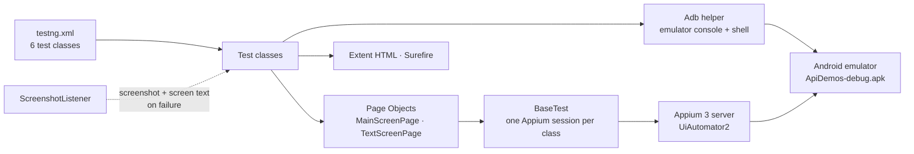

<div align="center">

# 📱 ApiDemos Mobile Automation — Appium + TestNG

### Android UI suite for Appium's official ApiDemos app — navigation, lifecycle, gestures, input, real interruptions, install cycle

[](https://git.io/typing-svg)

<!-- ============ STATUS BAR ============ -->
[](https://github.com/rbchy/AppiumAutomation_ApiDemos/actions/workflows/tests.yml)
-22c55e?style=for-the-badge&logo=checkmarx&logoColor=white)

-3DDC84?style=for-the-badge&logo=android&logoColor=white)


</div>

---

## 📌 At a Glance

<table>
<tr>
<td width="50%" valign="top">

**🙋 What this is**

A TestNG suite for **[ApiDemos](https://github.com/appium/android-apidemos)**, Appium's official Android test app. It covers what a mobile regression plan has to cover:

- installing, launching and uninstalling the app
- menu navigation and the back button
- scrolling, rotation and text input with the soft keyboard
- background and foreground, kill and relaunch
- **real interruptions sent through the emulator console:** an incoming call, an SMS, a 5 % battery, and Wi-Fi plus mobile data switched off

Every push runs the whole suite in **GitHub Actions** on an Android 13 emulator.

> *Every check confirms that the thing really happened. The call has to ring, the SMS has to land in the notification shade, and the battery has to read 5 %. Only then does the test check that the app survived.*

</td>
<td width="50%" valign="top">

**📍 Quick facts**

| | |
|---|---|
| 🧪 **Tests** | 56 in 6 classes |
| ✅ **CI** | 56 / 56 · **0 skipped** · ≈ 4 min of tests |
| 📱 **Device** | Pixel 6 emulator, Android 13 (API 33) |
| 🤖 **Driver** | Appium 3 + UiAutomator2 |
| 📊 **Reports** | Extent HTML · Surefire / TestNG |
| 📸 **On failure** | Screenshot + on-screen text in the log |

</td>
</tr>
</table>

---

## ✅ Latest Results

| Class | Tests | What is asserted | Result |
|---|---:|---|---|
| 📲 `InstallLifecycleTests` | 5 | Fresh install → main screen opens · reinstall over itself · uninstall → gone · reinstall → opens |  |
| 🔬 `CombinedApiDemosTests` | 25 | The 12 menu items, in order · each screen opens (checked by an item only that screen has) · scroll to *Views* · text kept exactly · keyboard opens and closes · landscape ↔ portrait · sub-screen survives background · device clock within 10 min · cold launch < 10 s |  |
| 🏢 `EnterpriseTestSuite` | 15 | Smoke · kill and relaunch · 3-level back navigation · rapid switching · session matches device Android version · empty field · typed text gone after kill · touch targets ≥ 48 dp |  |
| 📞 `InterruptSimulationTests` | 4 | Call rings (`mCallState=1`) and ends → *Missed call* in the shade · SMS text appears in the shade · Wi-Fi + data really off, then restored · battery reads 5 % — app usable after each |  |
| 🔗 `DeviceIntegrationTests` | 3 | Activity started directly (deep-link style) opens *Controls* · app notification posted to the notification manager · clipboard round trip |  |
| 🌐 `ApiIntegratedTests` | 4 | REST Assured: GET 200 with valid fields · POST 201 echoes the sent data · unknown id → 404 |  |
| **Total** | **56** | | **100 % · 0 skipped** |

<sub>GitHub Actions, Ubuntu, Temurin 17, Appium 3 + UiAutomator2, Pixel 6 emulator with Android 13 / API 33 ([workflow](.github/workflows/tests.yml)). The earlier local report ([Appium-Tests TestNG Report.pdf](Appium-Tests%20TestNG%20Report.pdf)) showed 55 passed and 3 skipped, from a local project whose support classes were never committed.</sub>

---

## 🏗️ Framework Architecture



- **No skips by design:** the text and keyboard tests use *Views › Controls › 1. Light Theme*, an EditText screen that every ApiDemos build has. There is no searching for some EditText and skipping when none is found.
- **Screens identified by their content:** a navigation check passes only if an item that exists only on the target screen appears, for example *Arcs* for Graphics or *Bouncing Balls* for Animation.
- **Interruptions are confirmed, not assumed:** `Adb` runs the emulator console and fails on a non-zero exit code. Each interruption is checked on the device itself through the telephony state, the notification shade, `mobile: batteryInfo` or `getConnection()`.
- **Self-healing start state:** `ensureOnMainScreen()` brings the app to the front and backs out to the main menu before every test. If that does not work, it restarts the app.
- **Fail fast:** `BaseTest` checks Appium's `/status` endpoint first and gives a readable message when the server is not running.

---

## 🛠️ Tech Stack

| Layer | Technology | Version |
|---|---|---|
| Language | Java | 17 |
| Mobile automation | Appium server + UiAutomator2 driver | 3.x |
| Client | Appium java-client · Selenium (pinned via BOM) | 9.5.0 · 4.32.0 |
| Test runner | TestNG | 7.10.2 |
| API checks | REST Assured | 5.4.0 |
| Reporting | Extent Reports (Spark) | 5.1.2 |
| CI | GitHub Actions + `reactivecircus/android-emulator-runner` | API 33, Pixel 6 |

---

## 📁 Project Structure

```
AppiumAutomation_ApiDemos/
├── .github/
│   ├── workflows/tests.yml              ← emulator + Appium on every push
│   └── scripts/run-appium-tests.sh      ← waits for Android services, starts Appium, runs a suite
├── src/test/java/
│   ├── base/BaseTest.java               ← Appium session per class, server pre-check
│   ├── pages/                           ← MainScreenPage, TextScreenPage
│   ├── tests/                           ← 6 test classes
│   ├── listeners/ScreenshotListener.java
│   └── utils/                           ← Adb, WaitUtils, ExtentReportManager
├── ApiDemos-debug.apk                   ← app under test
├── testng.xml                           ← full regression suite (one emulator)
├── crossdevice-testng.xml               ← enterprise checks on two emulators in parallel
└── pom.xml
```

---

## ⚙️ Getting Started

**Prerequisites:** JDK 17 · Maven 3.8+ · Node.js 20+ · Android SDK with an emulator (API 33 recommended)

```bash
git clone https://github.com/rbchy/AppiumAutomation_ApiDemos.git
cd AppiumAutomation_ApiDemos

npm install -g appium@3
appium driver install uiautomator2

emulator -avd <your-avd> &            # adb devices → emulator-5554  device
appium &                              # http://127.0.0.1:4723

mvn clean test                                           # full suite (testng.xml)
mvn clean test -DsuiteXmlFile=crossdevice-testng.xml     # two emulators: 5554 + 5556
mvn clean test -DappiumUrl=http://192.168.1.20:4723      # Appium on another machine
```

| Report | Location |
|---|---|
| Extent HTML | `test-output/ExtentReport.html` |
| Failure screenshots | `test-output/screenshots/` |
| Surefire / TestNG | `target/surefire-reports/` |

> The interrupt tests use emulator console commands (`adb emu gsm`, `sms`, `power`). They need an emulator, not a physical phone.

---

## 🧹 Maintenance Log

| Change | Why |
|---|---|
| Added `BaseTest`, `MainScreenPage`, `TextScreenPage`, `WaitUtils`, `ExtentReportManager`, `ScreenshotListener` | The tests imported all six, but **none were in the repo**, so the project could not compile |
| Added `InstallLifecycleTests` and a device-integration class | `testng.xml` listed `InstallLifecycleTests` and `MissingCoverageTests`, which did not exist |
| Tests moved to `src/test/java`, dependencies test-scoped | The code lived in `src/main/java`, so TestNG had to be a compile dependency |
| Text and keyboard tests use *1. Light Theme*; 3 skips removed | They searched the *Text* menu for any EditText and skipped when none was found |
| Navigation checks look for a screen-specific item | The data-driven check passed if `getCurrentPackage()` was non-empty, which is always true |
| Interrupts confirmed on the device | `Runtime.exec("adb …")` results were ignored, and the only check was "menu count > 0" |
| Keyboard test must see the keyboard | It passed whether or not the keyboard ever opened |
| Rotation asserts the orientation and a landscape window | Failures were turned into skips |
| *Simulated UI vs API* test replaced with a POST check | It compared the API title with itself |
| Removed `FirstAppiumTest` (a `main` method), `ApiDemosTest` (duplicate) and `pom.xml.bak` | Not tests, or duplicated elsewhere |
| GitHub Actions on an API 33 emulator | Every push is checked; the script waits for Android services before starting Appium |
| README describes only what exists | It described *Appium 3.5.2*, `src/test/resources/testng.xml`, a `rbchy/appium-tests` clone URL and a fixed 58-test count |

---

## 📈 Roadmap

- [x] Compilable framework, real assertions, emulator CI, zero skips
- [ ] API level matrix in CI (API 30 / 33 / 34)
- [ ] Run `crossdevice-testng.xml` in CI with two emulators
- [ ] WebView / hybrid context switching (*Views › WebView*)
- [ ] Drag and drop and multi-touch gestures with W3C actions
- [ ] Cloud real-device run (Sauce Labs / BrowserStack) with credentials from repository secrets

---

## 🔗 Related Projects

| Project | Stack |
|---|---|
| 🤖 [Appium Android Automation](https://github.com/rbchy/AppiumTest_Andriod_Automation) | ApiDemos with Cucumber + TestNG, CI green on an emulator |
| 🛍️ [Android UI — My Demo App E-Commerce](https://github.com/rbchy/AndroidUIAppiumTest_MyDemoEcommerce) | Sauce Labs My Demo App · 75 / 75 in CI |
| ☁️ [QA Brains — Sauce Labs](https://github.com/rbchy/QaBrainsSauceLabAPI_Automation) | Web suite, local or Sauce Labs cloud |
| ⭐ [RbcTcsWorld E-Commerce Suite](https://github.com/rbchy/RbcTcsWorld_ECommerceSuite) | Spring Boot · REST Assured · Selenium · Playwright · CI quality gates |

<sub>All projects: [github.com/rbchy](https://github.com/rbchy)</sub>

---

## 👤 Author

<div align="center">

**Ranajit Baran Chowdhury (RB Chowdhury)**
QA Automation Engineer / SDET · West Norriton, Pennsylvania, USA

[](https://www.linkedin.com/in/rbchy/)
[](https://github.com/rbchy)
[](https://rbchy.github.io/rbchy/)
[](https://rbc6543.wixsite.com/rbc-portfolio)
[](mailto:chyranajit@gmail.com)

<sub>ApiDemos is an open-source test app maintained by the Appium project.</sub>

⭐ *If this project helps you, a star on the repo is appreciated.*

</div>
